# TRIAD — System Architecture Specification

## 1. Executive Summary & Architectural Principles

TRIAD is a zero-additional-cost local Windows desktop workspace engineered to coordinate three independent desktop AI applications: **ChatGPT Desktop**, **Claude Desktop**, and **Gemini Desktop**.

Rather than relying on paid cloud APIs, external proxy relays, or resource-heavy local LLMs, TRIAD leverages the user's existing, signed-in Windows desktop installations. TRIAD coordinates these models through a structured multi-round deliberation protocol, synthesizing consensus while remaining strictly private, local, and transparent.

### Core Architectural Principles

1. **Zero Additional Cost**: No external API keys, hosted inference servers, or cloud subscriptions.
2. **Local & Privacy-Preserving**: All session states, candidate proposals, and debate transcripts reside exclusively on the user's local disk in a SQLite database.
3. **Strict Decoupling**: The Reasoning Coordination Layer is completely decoupled from desktop application integration mechanisms.
4. **Human-in-the-Loop Transparency**: TRIAD never masquerades human-assisted or clipboard-mediated interactions as fully automated background processes.
5. **Untrusted Model Output Model**: All imported model outputs are treated as untrusted text. No model output can modify TRIAD system configuration or bypass deliberation rules.
6. **Deterministic Consensus Calculus**: Voting outcomes (3/3 Unanimous, 2/3 Majority, No Consensus) are calculated via formal deterministic algorithms without heuristic guesswork.

---

## 2. Four-Tier Layered Architecture

TRIAD is organized into four clearly separated architectural tiers:

```mermaid
flowchart TD
    subgraph Presentation_Layer ["1. Presentation Layer (PySide6)"]
        UI_Dash["Dashboard & Agent Cards"]
        UI_Session["Session Manager & Workspace"]
        UI_Debate["Debate Viewer & Timeline"]
        UI_Disagreement["Disagreement Map"]
        UI_Consensus["Consensus & Voting View"]
        UI_Override["Human Oversight Controls"]
    end

    subgraph Coordination_Layer ["2. Reasoning Coordination Layer"]
        MOD_03["MOD-03: Session Manager"]
        MOD_04["MOD-04: Independent Reasoning"]
        MOD_05["MOD-05: Cross-Model Debate"]
        MOD_06["MOD-06: Devil's Advocate"]
        MOD_07["MOD-07: Claim & Evidence"]
        MOD_08["MOD-08: Consensus Engine"]
        MOD_09["MOD-09: Disagreement Map Engine"]
        MOD_11["MOD-11: Reasoning Mode Manager"]
        MOD_14["MOD-14: Security & Validation"]
    end

    subgraph Integration_Layer ["3. Integration Layer"]
        MOD_01["MOD-01: Desktop Connection Manager"]
        MOD_02["MOD-02: Message Exchange Bridge"]
        Clipboard["Safe Clipboard Subsystem"]
        Win32["Win32 Window Subsystem"]
        Optional_UI_Auto["Optional Accessibility Connectors"]
    end

    subgraph Persistence_Layer ["4. Persistence Layer"]
        MOD_10["MOD-10: Shared Memory Manager"]
        MOD_13["MOD-13: Session Replay & Export"]
        SQLite[("Local SQLite Database")]
        Exporter["Markdown / JSON / HTML Exporters"]
    end

    Presentation_Layer --> Coordination_Layer
    Coordination_Layer --> Integration_Layer
    Coordination_Layer --> Persistence_Layer
    Integration_Layer --> Persistence_Layer
```



### Layer Responsibilities

#### 1. Presentation Layer
- Renders the dark-themed desktop interface using PySide6.
- Displays agent statuses, real-time connection telemetry, and process indicators.
- Provides interactive visual timelines of discussion rounds, disagreement maps, ballot tallies, and human override dialogs.

#### 2. Reasoning Coordination Layer
- Completely headless and independent of UI or Windows APIs.
- Manages the lifecycle of multi-agent debate sessions, round progression, prompt synthesis, and stopping rules.
- Houses the deterministic voting calculus, Devil's Advocate assignment, and claim tracking.

#### 3. Integration Layer
- Manages the physical connection to the three Windows desktop applications.
- Encompasses Phase 1's Win32 process discovery and window management (`pywin32`, `psutil`).
- Implements the Message Exchange Bridge: safe clipboard transfer, prompt preparation, and response ingestion.

#### 4. Persistence Layer
- Encapsulates local SQLite persistence with automated schema migrations.
- Persists session metadata, prompt templates, raw responses, structured claims, ballots, and decisions.
- Generates reproducible Session Replays and exports (Markdown, JSON, HTML).

---

## 3. Module Inventory and Responsibilities

The system consists of fourteen specialized modules (MOD-01 through MOD-14):

```mermaid
classDiagram
    class MOD_01_DesktopConnectionManager {
        +scan_windows()
        +bind_candidate()
        +focus_window()
        +monitor_lifecycle()
    }
    class MOD_02_MessageExchangeBridge {
        +prepare_outbound_prompt()
        +copy_to_clipboard()
        +import_inbound_response()
        +validate_provenance()
    }
    class MOD_03_ReasoningSessionManager {
        +create_session()
        +advance_round()
        +transition_state()
        +check_stopping_rules()
    }
    class MOD_04_IndependentReasoningEngine {
        +generate_round1_prompts()
        +seal_response()
        +verify_round1_sealed()
    }
    class MOD_05_CrossModelDebateEngine {
        +synthesize_critique_prompts()
        +extract_counterarguments()
        +track_proposal_revisions()
    }
    class MOD_06_DevilsAdvocateEngine {
        +assign_advocate_role()
        +generate_challenge_prompt()
        +evaluate_challenge_impact()
    }
    class MOD_07_ClaimAndEvidenceManager {
        +extract_structured_claims()
        +map_supporting_evidence()
        +flag_unsubstantiated_claims()
    }
    class MOD_08_ConsensusEngine {
        +extract_candidate_proposals()
        +generate_ballot_templates()
        +compute_deterministic_tally()
        +compile_minority_report()
    }
    class MOD_09_DisagreementMap {
        +build_claim_matrix()
        +detect_consensus_deltas()
        +render_conflict_graph()
    }
    class MOD_10_SharedMemoryManager {
        +save_session()
        +get_session_history()
        +execute_migrations()
    }
    class MOD_11_ReasoningModeManager {
        +get_mode_parameters()
        +validate_mode_transition()
    }
    class MOD_12_HumanOversight {
        +apply_human_override()
        +resolve_proposal_ambiguity()
        +request_supplemental_round()
    }
    class MOD_13_SessionReplayAndExport {
        +replay_timeline()
        +export_markdown()
        +export_json()
    }
    class MOD_14_ReliabilityAndSecurity {
        +sanitize_untrusted_input()
        +detect_prompt_injection()
        +enforce_bounded_execution()
    }

    MOD_03 --> MOD_04
    MOD_03 --> MOD_05
    MOD_03 --> MOD_06
    MOD_03 --> MOD_08
    MOD_03 --> MOD_11
    MOD_03 --> MOD_10
    MOD_05 --> MOD_07
    MOD_08 --> MOD_09
    MOD_08 --> MOD_12
    MOD_03 --> MOD_14
    MOD_02 --> MOD_14
    MOD_03 --> MOD_02
    MOD_13 --> MOD_10
```



### Module Specifications

#### MOD-01: Desktop Connection Manager (Phase 1 Baseline)
- **Status**: Implemented in Phase 1 (`app/core/app_discovery.py`, `window_manager.py`, `agent_registry.py`, `connection_monitor.py`).
- **Function**: Discovers, registers, validates, monitors, and focuses native desktop windows for ChatGPT, Claude, and Gemini.
- **Constraints**: No private memory access, no thread injection, respects Windows foreground lock rules.

#### MOD-02: Message Exchange Bridge
- **Status**: Target for Phase 2.
- **Function**: Manages clean, user-authorized transfer of prompts into native application input boxes and ingests returned responses.
- **Mechanism**: Prepares model-tailored prompt payloads, copies them to the system clipboard, switches focus to the target window (via MOD-01), and provides an import modal for pasted model output.
- **Guarantees**: Records origin timestamp, prompt hash, and source agent attribution.

#### MOD-03: Reasoning Session Manager
- **Status**: Architecture defined.
- **Function**: Central state machine orchestrating debate progression.
- **States**: `DRAFT`, `INDEPENDENT_ROUND`, `DEBATE_ROUND`, `DEVILS_ADVOCATE`, `VOTING`, `CONSENSUS_REACHED`, `NO_CONSENSUS`, `OVERRIDDEN`, `TERMINATED`.
- **Invariants**: Enforces maximum round limits and halts on terminal consensus states.

#### MOD-04: Independent Reasoning Engine
- **Status**: Architecture defined.
- **Function**: Enforces strict epistemic independence during Round 1.
- **Invariant**: No model is exposed to another model's initial ideas until all three participants have submitted and sealed their Round 1 responses. Prevents premature framing bias and anchor effects.

#### MOD-05: Cross-Model Debate Engine
- **Status**: Architecture defined.
- **Function**: Generates structured critique prompts for Round 2 and beyond.
- **Payload Construction**: Presents Model B and Model C's arguments to Model A, prompting Model A to identify factual discrepancies, methodological flaws, or unaddressed assumptions.
- **Dampening**: Limits rebuttal rounds to prevent recursive unproductive arguments.

#### MOD-06: Devil's Advocate Engine
- **Status**: Architecture defined.
- **Function**: Inoculates against groupthink by stress-testing emerging consensus before final ballot submission.
- **Assignment**:
  - If a dissenting participant exists, that model is elevated to lead the challenge.
  - If initial answers are unanimous (3/3), a designated participant (or rotating challenger) is tasked with actively refuting the shared thesis.
- **Rule**: Challenging the consensus as Devil's Advocate does not automatically forfeit that model's vote in the final ballot.

#### MOD-07: Claim and Evidence Manager
- **Status**: Architecture defined.
- **Function**: Parses explicit structured claims and citations from imported responses.
- **Taxonomy**: Categorizes claims into `factual`, `methodological`, `architectural`, `assumption`, and `recommendation`.
- **Independence Check**: Flags unverified assertions; explicitly does not equate high model confidence or majority concurrence with factual ground truth.

#### MOD-08: Consensus Engine
- **Status**: Architecture defined.
- **Function**: Executes deterministic ballot aggregation across a canonical set of candidate proposals.
- **Tally Rules**:
  - `3/3 Unanimous`: Full alignment across all three participants.
  - `2/3 Majority`: Two models agree on the primary proposal; generates a mandatory Minority Report documenting the dissenter's rationale.
  - `No Consensus`: Three-way split (1/1/1) or refusal to align.
- **Equivalence Resolution**: If proposal boundaries are ambiguous, flags for human adjudication (MOD-12) rather than making heuristic assumptions.

#### MOD-09: Disagreement Map
- **Status**: Architecture defined.
- **Function**: Maintains an agent-by-claim matrix recording positions: `SUPPORT`, `OPPOSE`, `NEUTRAL`, or `UNADDRESSED`.
- **Visual Mapping**: Highlights unresolved core disputes, concessions made across rounds, and points of stubborn divergence.

#### MOD-10: Shared Memory Manager
- **Status**: Architecture defined.
- **Function**: Manages relational SQLite storage for full session state, schemas, and historical records.
- **Migrations**: Employs an explicit `schema_version` table with idempotent, forward-only migration scripts.
- **Privacy Guarantee**: Operates strictly on the local machine (`%LOCALAPPDATA%/TRIAD/triad_workspace.db`).

#### MOD-11: Reasoning Mode Manager
- **Status**: Architecture defined.
- **Function**: Configures round limits, prompt templates, decision thresholds, and reporting formats across five specialized operational modes:

| Mode | Default Rounds | Key Focus & Prompt Template | Stopping Rules | Output Format |
|---|---|---|---|---|
| **Quick Consensus** | 1 Round (Max 1) | Direct Independent Answer + Immediate Structured Ballot. | Terminates after Round 1 ballot collection. | Fast Consensus Summary with Vote Tally. |
| **Deep Debate** | 3 Rounds (Max 4) | Cross-Model Critique, Methodological Challenge, Devil's Advocate Stress-Test. | Convergence (all agree in Rd 2) or Stagnation (no new claims for 2 rds). | Comprehensive Deliberation Report with Disagreement Map and Minority Report. |
| **Research Council** | 3 Rounds (Max 3) | Claim Extraction, Source Citation Analysis, Evidence Substantiation. | Exhaustion of unverified factual challenges. | Evidence Matrix, Verified Claims, and Unresolved Citations. |
| **Code Review Council** | 3 Rounds (Max 3) | Static Analysis, Concurrency, Security Vulnerability, Edge Cases, API Design. | Security flaws refuted or consensus remediation adopted. | Unified Architecture Review, Vulnerability Ledger, and Benchmark Trade-offs. |
| **Creative Council** | 2 Rounds (Max 3) | Divergent Brainstorming -> Cross-Pollination -> Multi-Criteria Selection. | Creative proposal convergence on top 2 concepts. | Idea Matrix, Trade-off Grid, and Synthesized Hybrid Proposal. |

#### MOD-12: Human Oversight
- **Status**: Architecture defined.
- **Function**: Grants the human operator absolute authority over session lifecycle.
- **Capabilities**:
  - Inject supplemental rounds.
  - Manually override consensus verdicts with recorded rationale.
  - Adjudicate ambiguous candidate proposals.
  - Edit or redact erroneous prompt transfers.
- **Audit Ledger**: Every human action is recorded with an immutable timestamp in `user_audit_log`.

#### MOD-13: Session Replay and Export
- **Status**: Architecture defined.
- **Function**: Reconstructs the exact chronological evolution of the discussion.
- **Export Targets**:
  - Self-contained Markdown summary report.
  - Machine-readable structured JSON document (including full claim graph and ballots).
  - Standalone HTML printout with embedded styling.

#### MOD-14: Reliability and Security
- **Status**: Architecture defined.
- **Function**: Defense-in-depth against prompt injection, clipboard hijacking, and corrupted payloads.
- **Untrusted Ingestion Boundary**: Treats imported text as untrusted raw string data. Isolates system instructions from user/model content via strict delimiter envelopes (`<<<UNTRUSTED_CONTENT>>>`).

---

## 4. End-to-End Reasoning Workflow

The formal 14-step workflow governing every TRIAD session:

```mermaid
sequenceDiagram
    autonumber
    actor User as Human Operator
    participant UI as TRIAD Presentation (UI)
    participant SM as Session Manager (MOD-03)
    participant IR as Independent Engine (MOD-04)
    participant Bridge as Exchange Bridge (MOD-02)
    participant Apps as Desktop AI Apps (ChatGPT / Claude / Gemini)
    participant Debate as Debate Engine (MOD-05/06)
    participant CE as Consensus Engine (MOD-08)
    participant DB as SQLite Storage (MOD-10)

    User->>UI: 1. Create Session (Prompt & Mode)
    UI->>SM: 2. Initialize Session
    SM->>DB: Record Session Draft

    rect rgb(20, 24, 32)
        Note over SM, Apps: Independent Round (Round 1)
        SM->>IR: 3. Prepare Independent Prompts
        IR->>Bridge: Stage Prompt for Agent
        Bridge->>User: 4. Copy Prompt & Focus Desktop Window
        User->>Apps: Paste & Generate Response
        User->>Bridge: 5. Import Response
        Bridge->>IR: Ingest Raw Text
        IR->>DB: 6. Seal Round 1 Response (Immutable)
        Note over IR: Await all 3 responses before unsealing
    end

    rect rgb(28, 24, 20)
        Note over SM, Apps: Cross-Model Critique & Debate (Rounds 2+)
        SM->>Debate: 7. Synthesize Cross-Model Critique Prompts
        Debate->>Bridge: Stage Critique Prompts
        Bridge->>User: 8. Transfer Prompts to Apps
        User->>Apps: Paste & Generate Rebuttals
        User->>Bridge: Import Rebuttals
        Bridge->>Debate: 9. Record Counter-Arguments & Concessions
    end

    opt Devil's Advocate Enabled
        SM->>Debate: 10. Execute Devil's Advocate Round
        Debate->>User: Transfer Stress-Test Challenge
        User->>Apps: Solicit Defense of Consensus
        User->>Bridge: Import Defenses
    end

    rect rgb(20, 28, 24)
        Note over SM, CE: Voting & Consensus
        SM->>CE: 11. Solicit Structured Final Ballots
        User->>Apps: Transfer Ballot Prompt
        User->>Bridge: Import Ballots
        CE->>CE: 12. Compute Deterministic Consensus (3/3 or 2/3)
        CE->>DB: Persist Decision, Tally & Minority Report
    end

    CE->>UI: 13. Display Decision, Disagreements & Minority Report
    UI->>User: 14. Offer Export (Markdown / JSON) & Replay
```



---

## 5. Security & Prompt Injection Mitigation

Because TRIAD imports text generated by three external AI models, it implements strict boundaries to protect workspace integrity:

1. **System Delimiter Envelopes**: Outbound critique prompts wrap foreign model responses in explicit cryptographic or structured delimiters (e.g. `<<<BEGIN_UNTRUSTED_EXTERNAL_MODEL_OUTPUT>>>`). System meta-prompts explicitly instruct the receiving model to treat enclosed text as subject matter for evaluation, not as execution instructions.
2. **Zero In-Process Script Execution**: Model responses are stored and processed purely as text. TRIAD contains no JavaScript/Python `eval` or dynamic template execution over model output.
3. **No Automated Tool Access**: Models in consumer desktop windows have no direct access to local filesystem paths, network sockets, or OS shell execution through TRIAD.
4. **Clipboard Cleansing**: The clipboard bridge verifies text payloads, strips binary or shell executable formatting, and enforces reasonable buffer length boundaries (e.g., maximum 500,000 characters per response).

---

## 6. Compatibility & Architectural Decoupling

The Reasoning Coordination Layer does not import `win32gui`, `win32process`, or `psutil`. It interacts with external models through the abstract `IMessageBridge` interface:

```python
from typing import Protocol, Optional
from app.models.session import ModelResponse

class IMessageBridge(Protocol):
    def dispatch_prompt(self, agent_id: str, prompt_text: str) -> bool:
        """Stages a prompt for delivery to the targeted AI application."""
        ...

    def receive_response(self, agent_id: str, round_number: int) -> Optional[ModelResponse]:
        """Retrieves user-imported or connector-delivered response text."""
        ...
```

This ensures that:
- Automated test suites can mock `IMessageBridge` completely to test multi-round debate logic without launching desktop windows.
- Future authorized accessibility or API integrations can be swapped into the Integration Layer without modifying the reasoning, debate, or consensus algorithms.
