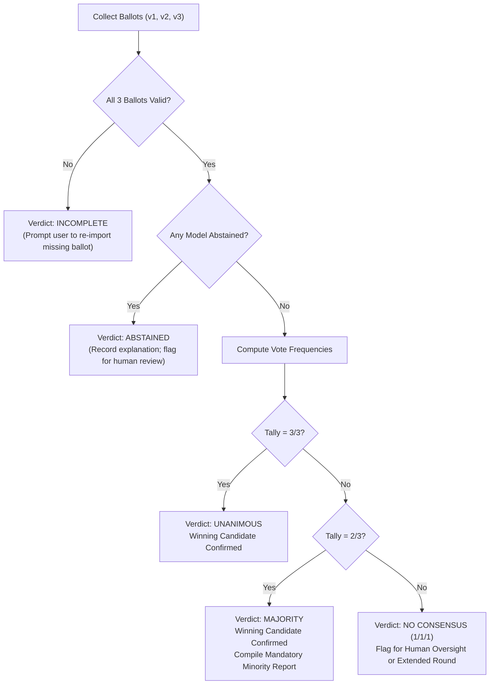

# TRIAD — Consensus Protocol Specification

## 1. Objectives & Overview

The TRIAD Consensus Protocol governs the extraction of candidate proposals, structured ballot submission, debate progression, and deterministic voting across three independent desktop AI applications (**ChatGPT**, **Claude**, and **Gemini**).

The protocol prevents groupthink, catches single-model hallucinations, and provides a formal audit trail from initial prompts to final conclusions.

### Protocol Principles

1. **Deterministic Calculation**: Voting results are computed using strict mathematical tallies (3/3 Unanimous, 2/3 Majority, 1/1/1 No Consensus). No heuristic AI interpretation is used to determine the winner.
2. **First-Round Epistemic Independence**: Initial responses are formulated in isolation without access to peer outputs.
3. **Institutional Skepticism (Devil's Advocate)**: Emerging agreements must withstand targeted adversarial stress-testing.
4. **First-Class Minority Dissent**: Dissenting views are never discarded; they are compiled into structured Minority Reports.
5. **Human Primacy**: The human operator retains authority to adjudicate ambiguous candidates, request supplemental rounds, or override verdicts.

---

## 2. Common Candidate Proposals & Equivalence

Before final voting can take place, the reasoning engine synthesizes the set of distinct proposals emerging from the discussion rounds into a canonical list of **Candidate Proposals**.

### Candidate Proposal Schema

```json
{
  "candidate_id": "PROP-A",
  "title": "Asynchronous Event-Driven Architecture with Dead-Letter Queues",
  "summary": "Implement decoupled message processing using local durable storage and retry limits.",
  "proposed_by": "claude",
  "first_round": 1,
  "key_arguments": [
    "Prevents system lockup under heavy burst loads.",
    "Isolates consumer failures from upstream producers."
  ]
}
```

### Equivalence Resolution Rules

When models propose functionally equivalent approaches using different terminology (e.g., "Event Bus" vs "Message Broker"):
1. **Semantic Merging**: If the core methodology and tradeoffs are identical, the proposals are merged under a unified candidate ID with both models credited as co-proposers.
2. **Ambiguity Gate (Human Review)**: If it is uncertain whether two proposals represent the same design or distinct alternatives, TRIAD pauses and presents the comparison to the human operator:
   - **Merge**: Treat as one unified proposal with shared candidate ID.
   - **Split**: Treat as two distinct proposals with separate candidate IDs.
3. **No Automatic Assumptions**: TRIAD never silently consolidates proposals without verifiable structural equivalence or human confirmation.

---

## 3. Structured Ballot Specification

During the voting round (`VOTING`), each model receives a standardized voting prompt requiring a structured ballot.

### Ballot Prompt Structure

```text
<<<SYSTEM_PROMPT>>>
You are participating as an independent voting member of the TRIAD Reasoning Council.
The council has deliberated and formulated the following candidate proposals:

[PROP-A]: Asynchronous Event-Driven Architecture
[PROP-B]: Synchronous Request-Response with Circuit Breaker
[PROP-C]: Hybrid Direct Execution with Fallback Queue

Please cast your definitive ballot by responding in the exact structured format below:

<<<BALLOT_START>>>
VOTE: [PROP-A | PROP-B | PROP-C | ABSTAIN]
CONFIDENCE: [0.0 - 1.0]
PRIMARY_JUSTIFICATION: [1-3 sentences explaining why this proposal best satisfies the requirements]
UNRESOLVED_RISK: [Acknowledge any remaining drawback or risk in your chosen proposal]
DISSENT_EXPLANATION: [If you disagree with the emerging consensus around another proposal, state your core objection here. Otherwise write NONE.]
<<<BALLOT_END>>>
<<<USER_CONTENT>>>
```

### Ingestion Validation

When a ballot is imported via the Message Exchange Bridge (MOD-02):
- The `VOTE` token is matched against valid candidate IDs (`PROP-A`, `PROP-B`, etc.) or `ABSTAIN`.
- If a model outputs free-form prose without the structured delimiter envelope, TRIAD marks the ballot as unparsed and provides a guided review modal for the user to confirm the model's intended choice.

---

## 4. Deterministic Voting Calculus

Let $N = 3$ be the number of participating desktop AI models. Let $V = \{v_1, v_2, v_3\}$ be the votes cast.



### Verdict Definitions

| Verdict | Tally Condition | Decision Action |
|---|---|---|
| **UNANIMOUS** | $3/3$ for single candidate | Winner ratified. Full alignment confirmed across all participants. |
| **MAJORITY** | $2/3$ for candidate $C_i$, $1/3$ for $C_j$ | Winner ratified under majority rule. Minority Report extracted from dissenting participant. |
| **NO CONSENSUS** | $1/1/1$ split across 3 distinct candidates | No winner declared. Options: Trigger supplemental debate round or invoke Human Override. |
| **INCOMPLETE** | Fewer than 3 valid ballots received | Process paused. Prompts operator to supply remaining ballot. |
| **ABSTAINED** | $\ge 1$ model explicitly abstains | Evaluates remaining votes. If remaining 2 agree, triggers provisional majority with abstention note. |

---

## 5. Devil's Advocate Protocol

To safeguard against artificial consensus, premature convergence, or sycophancy, TRIAD incorporates an explicit **Devil's Advocate Protocol** (MOD-06).

### 1. Trigger Conditions
- Enabled by default in `Deep Debate`, `Research Council`, and `Code Review Council` modes.
- Executed after Round 2 if an initial consensus emerges ($3/3$ or $2/3$ preliminary support).

### 2. Role Assignment
- **Case 1 (Natural Dissenter)**: If Round 2 results in a $2/3$ split, the model proposing or supporting the minority position is formally assigned the Devil's Advocate role.
- **Case 2 (Unanimous Agreement)**: If all three models support the same preliminary thesis ($3/3$), TRIAD designates one participant (rotated across sessions) to serve as Devil's Advocate:
  > *"You are designated as the Council's Devil's Advocate. Even if you personally agree with the prevailing consensus, your explicit assignment is to construct the strongest possible adversarial critique against it. Identify latent failure modes, invalid assumptions, cost escalations, and edge cases."*

### 3. Separation from Voting
- **Critical Invariant**: Fulfilling the Devil's Advocate mandate does **not** force the model to change its final vote. When casting its subsequent ballot, the model evaluates whether the majority successfully defended against the challenge.

---

## 6. Minority Report Protocol

When a decision is reached via **MAJORITY (2/3)**:

1. **Mandatory Extraction**: TRIAD extracts the dissenting model's `DISSENT_EXPLANATION` and unaddressed objections.
2. **Structured Co-Location**: The Minority Report is permanently coupled with the final decision in local storage and exports:
   ```markdown
   ### Consensus Verdict: MAJORITY (2/3) — Proposal PROP-A Approved
   - **Supporting Models**: Claude Desktop, Gemini Desktop
   - **Dissenting Model**: ChatGPT Desktop
   
   #### Minority Report (ChatGPT Desktop)
   > "While PROP-A offers architectural decoupling, it introduces severe operational complexity in state synchronization. The proposal lacks a distributed transaction recovery mechanism, which will lead to silent data drift during transient network splits."
   ```
3. **Traceability**: The user is provided direct links to the specific claims and debate rounds where the dissenting arguments were articulated.

---

## 7. Smart Stopping Rules

To ensure sessions terminate efficiently without runaway iterations:

1. **Convergence Stopping**: If Round 2 reveals that all three models have independently converged onto the same proposal and have answered all cross-critiques without objection, TRIAD offers an immediate transition to the final ballot.
2. **Stagnation Stopping**: If two consecutive debate rounds yield zero newly introduced claims, zero revised positions, and identical objection matrices, TRIAD flags the debate as stalled and forces a transition to voting.
3. **Hard Ceiling**: Every reasoning mode enforces an immutable round limit (`max_rounds`):
   - `Quick Consensus`: 1 round
   - `Deep Debate`: 4 rounds
   - `Research Council`: 3 rounds
   - `Code Review Council`: 3 rounds
   - `Creative Council`: 3 rounds

---

## 8. Human Override Protocol

The human operator has ultimate governance authority (MOD-12):

1. **Override Capabilities**:
   - **Adopt Minority Proposal**: Overrule a 2/3 majority in favor of the dissenting proposal.
   - **Enact Compromise/Custom Decision**: Formulate a synthesized alternative incorporating elements from both sides.
   - **Force Supplemental Round**: Direct the models to debate a specific unresolved claim before final voting.
2. **Audit Logging**: Every override requires the user to input a brief justification string, which is written to the immutable SQLite `user_audit_log` with an ISO-8601 UTC timestamp.
