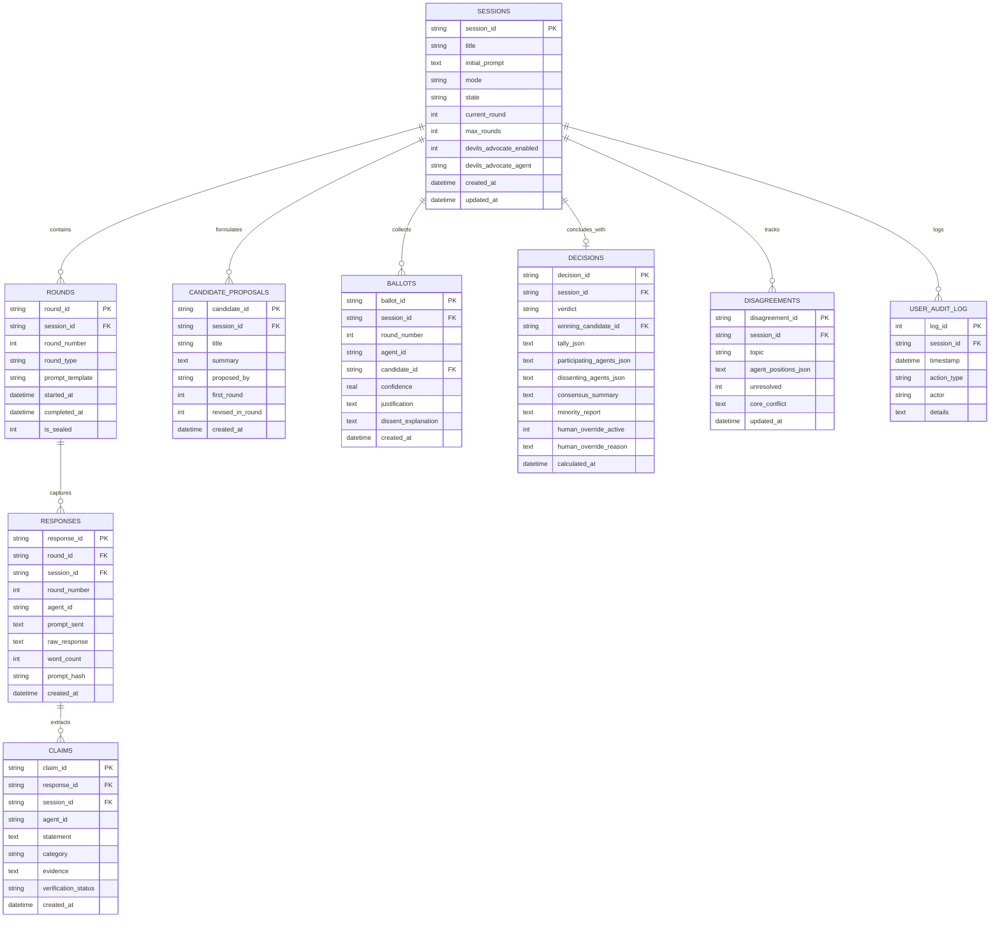

# TRIAD — Data Model Specification

## 1. Storage Principles & Overview

TRIAD stores all reasoning sessions, discussion rounds, structured claims, ballots, and configuration locally in a relational SQLite database located at:

`%LOCALAPPDATA%\TRIAD\triad_workspace.db`

### Core Data Principles

1. **Strictly Local**: Data never leaves the user's workstation.
2. **No Credential Storage**: Passwords, API tokens, browser cookies, and session secrets are never stored.
3. **Decoupled Runtime**: Transient Windows runtime identities (`HWND`, `PID`) are never persisted across application restarts.
4. **Immutability of Sealed Rounds**: Initial independent responses (Round 1) and historical round transcripts cannot be modified once sealed.
5. **Versioned Migrations**: Schema updates are managed via automated, forward-only idempotent migrations.

---

## 2. Entity Relationship Diagram



---

## 3. Relational Table Specifications

### 3.1 `sessions`
The top-level entity representing a deliberation session.

```sql
CREATE TABLE IF NOT EXISTS sessions (
    session_id TEXT PRIMARY KEY,
    title TEXT NOT NULL,
    initial_prompt TEXT NOT NULL,
    mode TEXT NOT NULL CHECK(mode IN ('quick_consensus', 'deep_debate', 'research_council', 'code_review', 'creative_council')),
    state TEXT NOT NULL CHECK(state IN ('draft', 'independent_round', 'debate_round', 'devils_advocate', 'voting', 'consensus_reached', 'no_consensus', 'overridden', 'terminated')),
    current_round INTEGER DEFAULT 0,
    max_rounds INTEGER NOT NULL,
    devils_advocate_enabled INTEGER DEFAULT 1,
    devils_advocate_agent TEXT,
    created_at TIMESTAMP NOT NULL,
    updated_at TIMESTAMP NOT NULL
);
```

### 3.2 `rounds`
Tracks discrete stages of deliberation within a session.

```sql
CREATE TABLE IF NOT EXISTS rounds (
    round_id TEXT PRIMARY KEY,
    session_id TEXT NOT NULL REFERENCES sessions(session_id) ON DELETE CASCADE,
    round_number INTEGER NOT NULL,
    round_type TEXT NOT NULL CHECK(round_type IN ('independent', 'cross_critique', 'revision', 'devils_advocate', 'ballot')),
    prompt_template TEXT NOT NULL,
    started_at TIMESTAMP NOT NULL,
    completed_at TIMESTAMP,
    is_sealed INTEGER DEFAULT 0,
    UNIQUE(session_id, round_number)
);
```

### 3.3 `responses`
Raw, immutable responses captured from the desktop AI applications.

```sql
CREATE TABLE IF NOT EXISTS responses (
    response_id TEXT PRIMARY KEY,
    round_id TEXT NOT NULL REFERENCES rounds(round_id) ON DELETE CASCADE,
    session_id TEXT NOT NULL REFERENCES sessions(session_id) ON DELETE CASCADE,
    round_number INTEGER NOT NULL,
    agent_id TEXT NOT NULL CHECK(agent_id IN ('chatgpt', 'claude', 'gemini')),
    prompt_sent TEXT NOT NULL,
    raw_response TEXT NOT NULL,
    word_count INTEGER DEFAULT 0,
    prompt_hash TEXT,
    created_at TIMESTAMP NOT NULL
);
```

### 3.4 `claims`
Atomic claims extracted from model responses for verification and disagreement mapping.

```sql
CREATE TABLE IF NOT EXISTS claims (
    claim_id TEXT PRIMARY KEY,
    response_id TEXT NOT NULL REFERENCES responses(response_id) ON DELETE CASCADE,
    session_id TEXT NOT NULL REFERENCES sessions(session_id) ON DELETE CASCADE,
    agent_id TEXT NOT NULL,
    statement TEXT NOT NULL,
    category TEXT NOT NULL CHECK(category IN ('factual', 'methodological', 'architectural', 'assumption', 'recommendation')),
    evidence TEXT,
    verification_status TEXT NOT NULL DEFAULT 'unverified' CHECK(verification_status IN ('unverified', 'supported', 'disputed', 'refuted')),
    created_at TIMESTAMP NOT NULL
);
```

### 3.5 `candidate_proposals`
The distinct, competing solutions identified across the deliberation.

```sql
CREATE TABLE IF NOT EXISTS candidate_proposals (
    candidate_id TEXT PRIMARY KEY,
    session_id TEXT NOT NULL REFERENCES sessions(session_id) ON DELETE CASCADE,
    title TEXT NOT NULL,
    summary TEXT NOT NULL,
    proposed_by TEXT NOT NULL,
    first_round INTEGER NOT NULL,
    revised_in_round INTEGER,
    created_at TIMESTAMP NOT NULL
);
```

### 3.6 `ballots`
Formal voting records cast by each model.

```sql
CREATE TABLE IF NOT EXISTS ballots (
    ballot_id TEXT PRIMARY KEY,
    session_id TEXT NOT NULL REFERENCES sessions(session_id) ON DELETE CASCADE,
    round_number INTEGER NOT NULL,
    agent_id TEXT NOT NULL,
    candidate_id TEXT NOT NULL REFERENCES candidate_proposals(candidate_id),
    confidence REAL NOT NULL CHECK(confidence >= 0.0 AND confidence <= 1.0),
    justification TEXT NOT NULL,
    dissent_explanation TEXT,
    created_at TIMESTAMP NOT NULL,
    UNIQUE(session_id, round_number, agent_id)
);
```

### 3.7 `decisions`
The deterministic outcome of the consensus calculation.

```sql
CREATE TABLE IF NOT EXISTS decisions (
    decision_id TEXT PRIMARY KEY,
    session_id TEXT NOT NULL UNIQUE REFERENCES sessions(session_id) ON DELETE CASCADE,
    verdict TEXT NOT NULL CHECK(verdict IN ('unanimous', 'majority', 'no_consensus', 'incomplete', 'abstained')),
    winning_candidate_id TEXT REFERENCES candidate_proposals(candidate_id),
    tally_json TEXT NOT NULL,
    participating_agents_json TEXT NOT NULL,
    dissenting_agents_json TEXT NOT NULL,
    consensus_summary TEXT NOT NULL,
    minority_report TEXT,
    human_override_active INTEGER DEFAULT 0,
    human_override_reason TEXT,
    calculated_at TIMESTAMP NOT NULL
);
```

### 3.8 `user_audit_log`
Immutable audit log tracking all human interventions.

```sql
CREATE TABLE IF NOT EXISTS user_audit_log (
    log_id INTEGER PRIMARY KEY AUTOINCREMENT,
    session_id TEXT REFERENCES sessions(session_id) ON DELETE CASCADE,
    timestamp TIMESTAMP NOT NULL,
    action_type TEXT NOT NULL,
    actor TEXT NOT NULL DEFAULT 'human_operator',
    details TEXT NOT NULL
);
```

---

## 4. Schema Migration Strategy

Database versioning is tracked via the `schema_migrations` table:

```sql
CREATE TABLE IF NOT EXISTS schema_migrations (
    version INTEGER PRIMARY KEY,
    applied_at TIMESTAMP NOT NULL,
    description TEXT NOT NULL
);
```

### Migration Execution
1. During startup, `DatabaseManager` inspects `MAX(version)` from `schema_migrations`.
2. Each migration script is executed in an isolated atomic transaction (`BEGIN TRANSACTION` / `COMMIT`).
3. If an error occurs, the transaction rolls back cleanly, preventing partial schema corruption.

---

## 5. JSON Export & Replay Serialization Schema

Exported session files serialize the complete relational graph into a unified JSON structure:

```json
{
  "triad_export_version": "1.0",
  "exported_at": "2026-11-21T13:30:00Z",
  "session": {
    "session_id": "sess_89f02c",
    "title": "Architecting Zero-Cost Consensus Workspace",
    "mode": "deep_debate",
    "state": "consensus_reached",
    "verdict": "majority",
    "decision": {
      "winning_candidate_id": "PROP-A",
      "tally": { "PROP-A": 2, "PROP-B": 1 },
      "consensus_summary": "Majority agreement on client-assisted clipboard bridge.",
      "minority_report": "ChatGPT dissenting regarding manual latency overhead."
    },
    "proposals": [...],
    "rounds": [
      {
        "round_number": 1,
        "round_type": "independent",
        "responses": {
          "chatgpt": { "word_count": 420, "raw_response": "..." },
          "claude": { "word_count": 512, "raw_response": "..." },
          "gemini": { "word_count": 488, "raw_response": "..." }
        }
      }
    ]
  }
}
```

