# TRIAD — Message Exchange Protocol & Workflow Specification

## 1. Overview & Operational Philosophy

The **Message Exchange Bridge (`MOD-02`)** establishes a reliable, user-controlled communication channel between the TRIAD desktop workspace and existing signed-in AI desktop applications (**ChatGPT**, **Claude**, and **Gemini**).

### Core Principles

1. **Zero Additional Cost**: Uses the user's authentic desktop application sessions without external API tokens, subscription fees, or cloud proxy servers.
2. **User-in-the-Loop Control**: Prompts are copied and windows focused only upon explicit user invocation. TRIAD never types unattended or clicks "Send" automatically.
3. **Epistemic Isolation (Round 1)**: First-round prompts strictly contain the user's problem statement and framing rules. No model is exposed to peer answers until all three Round 1 responses have been verified and sealed.
4. **Verifiable Response Provenance**: Every imported response is assigned a cryptographic SHA-256 hash, word count, character count, and revision number.
5. **Untrusted Model Output Handling**: All imported responses are treated as untrusted text. No model output can modify TRIAD system settings or bypass deliberation rules.

---

## 2. Complete Round 1 Message Exchange Workflow

```mermaid
sequenceDiagram
    autonumber
    actor User as Human Operator
    participant UI as TRIAD Reasoning Workspace
    participant Bridge as MessageExchangeBridge (MOD-02)
    participant WM as WindowManager (MOD-01)
    participant Clip as Windows Clipboard
    participant App as Target AI Desktop App
    participant DB as SQLite Storage

    User->>UI: 1. Enter Title & Question
    User->>UI: 2. Click "Create Reasoning Session"
    UI->>Bridge: create_session(title, question)
    Bridge->>DB: Persist Session & Stage 3 Isolated Prompts
    Bridge-->>UI: Session Ready (State: ROUND_1_READY)

    rect rgb(20, 24, 32)
        Note over User, App: Step A: ChatGPT Transfer
        User->>UI: 3. Click "Copy & Focus ChatGPT"
        UI->>Bridge: copy_and_focus(session_id, 1, "chatgpt")
        Bridge->>Clip: Write Formatted Prompt
        Bridge->>WM: focus_window(chatgpt_hwnd)
        WM->>App: Bring ChatGPT to Foreground
        User->>App: 4. Paste (Ctrl+V) & Submit Prompt
        App-->>User: Generates Independent Answer
        User->>App: 5. Copy Response (Ctrl+C)
        User->>UI: 6. Return to TRIAD & Click "Import Response"
        UI->>UI: Open ResponseImportDialog (Preloads Clipboard)
        User->>UI: 7. Inspect Telemetry & Click "Accept Response"
        UI->>Bridge: import_response(session_id, 1, "chatgpt", text)
        Bridge->>DB: Store with SHA-256 Hash & Timestamp
        Bridge-->>UI: ChatGPT Response Accepted
    end

    rect rgb(28, 24, 20)
        Note over User, App: Step B: Claude Transfer
        User->>UI: 8. Repeat Copy & Focus for Claude
        User->>App: Paste & Copy Claude Output
        User->>UI: 9. Import & Confirm Claude Response
        Bridge->>DB: Store Claude Response
    end

    rect rgb(20, 28, 24)
        Note over User, App: Step C: Gemini Transfer
        User->>UI: 10. Repeat Copy & Focus for Gemini
        User->>App: Paste & Copy Gemini Output
        User->>UI: 11. Import & Confirm Gemini Response
        Bridge->>DB: Store Gemini Response
    end

    Bridge->>Bridge: 12. Evaluate 3/3 Acceptance
    Bridge->>DB: Update State to ROUND_1_COMPLETE
    Bridge-->>UI: "3/3 Responses Collected — Independent Round Complete — Ready for Cross-Model Discussion"
```



---

## 3. Prompt Construction & Formatting

Outbound Round 1 prompts are framed using structured delimiter envelopes:

```text
<<<TRIAD_REASONING_COUNCIL: ROUND 1 (INDEPENDENT)>>>
Participant: ChatGPT Desktop
Topic: Distributed Architecture Consensus

Problem Statement / Question:
Compare event-driven architecture versus synchronous request-response for high-throughput financial transactions. Address fault tolerance, latency, and data consistency.

Instructions:
1. Formulate your independent analysis and detailed recommendation.
2. Explicitly outline any core assumptions, technical tradeoffs, or constraints.
3. Note: This is an isolated round; you have not been provided with peer answers. Please focus solely on the provided problem statement.
<<<END_PROMPT>>>
```

### Isolation Invariant
- **Strict Prohibition**: Round 1 prompts never reference or inject text from another participant.
- **Traceability**: Outbound prompts are recorded in the `session_prompts` table with their creation and copy timestamps.

---

## 4. Response Verification & Cryptographic Provenance

When the operator imports a model response:

1. **Pre-Validation**:
   - Rejects null, empty, or whitespace-only inputs.
   - Enforces a safe 1,000,000 character buffer ceiling to prevent UI memory starvation.
2. **Integrity Hashing**:
   - Computes `SHA-256 = hashlib.sha256(cleaned_text.encode('utf-8')).hexdigest()`.
   - Counts total words and characters.
3. **Duplicate & Revision Handling**:
   - If an agent already has an accepted response for the current round, TRIAD prompts the user to confirm whether this is a **Revision**.
   - If confirmed, the revision number increments (`revision_number = 2, 3...`) and the updated response is saved without overwriting the historical submission.
4. **Attribution Guarantee**:
   - The response is bound to `(session_id, round_number, agent_id)`.

---

## 5. Technical Limitations & Security Safeguards

| Threat / Risk | Architectural Mitigation |
|---|---|
| **Accidental Clipboard Overwrite** | TRIAD never writes to the clipboard automatically. Outbound copy requires an explicit user button click. |
| **Empty or Corrupted Clipboard** | `ResponseImportDialog` validates text length and disables the "Accept" button if the editor is empty. |
| **Prompt Injection from Model** | Model output is treated as untrusted text. Delimiter envelopes (`<<<UNTRUSTED_CONTENT>>>`) prevent models from escaping prompt contexts or issuing commands. |
| **Window Focus Throttling** | If Windows foreground restrictions prevent immediate window elevation, TRIAD displays a clear notice while ensuring the clipboard payload remains valid. |
| **Cross-Model Contamination** | The `MessageExchangeBridge` enforces isolated generation templates in Round 1, preventing cross-leakage. |

