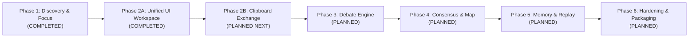

# TRIAD — Development Roadmap & Phase Gating

This document outlines the phased engineering milestones, feature mapping, and quality gates for the TRIAD Local AI Consensus Workspace.

---

## Roadmap Overview & Feature Matrix

| Phase | Milestone Name | Status | Modules Implemented | Key Deliverables |
|---|---|---|---|---|
| **Phase 1** | Desktop Discovery & Connection | **COMPLETED** | MOD-01 | Win32 discovery, HWND/PID tracking, window focus, SQLite settings, PySide6 UI. |
| **Phase 2A** | Unified Desktop Workspace UI | **COMPLETED** | MOD-01, MOD-03 | Collapsible navigation sidebar, multiline prompt composer, 3 participant panels, discussion timeline, consensus & disagreement empty states, SQLite session repository (71 tests passing). |
| **Phase 2B** | User-Controlled Message Exchange | Planned (Next) | MOD-02, MOD-14 | Prompt staging, safe clipboard bridge, import modals, response sealing, SHA-256 integrity, session restore. |
| **Phase 3** | Reasoning & Cross-Model Debate Engine | Planned | MOD-03, MOD-04, MOD-05, MOD-06, MOD-11 | Epistemic independence (Round 1), critique prompts, Devil's Advocate mode, 5 reasoning modes. |
| **Phase 4** | Consensus, Balloting & Disagreement Map | Planned | MOD-07, MOD-08, MOD-09, MOD-12 | Deterministic voting (3/3, 2/3), proposal equivalence, Minority Reports, Disagreement Map, human overrides. |
| **Phase 5** | Shared Memory, Replay & Export | Planned | MOD-10, MOD-13 | Versioned SQLite relational schema, interactive timeline replay, Markdown/JSON/HTML export. |
| **Phase 6** | Hardening, OS Matrix & Packaging | Planned | MOD-01–14 | Standalone PyInstaller binary, Windows 10/11 testing matrix, performance tuning. |

---

## Phase Details & Acceptance Criteria

### Phase 1: Native Desktop Application Connection (COMPLETED)
- **Status**: Operational & Verified (`29/29 tests passing`).
- **Core Capabilities**:
  - Discovers running instances of ChatGPT Desktop, Claude Desktop, and Gemini Desktop.
  - Resolves multi-window ambiguities with interactive user selection.
  - Restores minimized windows and brings target windows to foreground.
  - Continuous background health monitoring detecting window closes and process termination.
  - Local SQLite preference storage without saving transient runtime handles across reboots.

---

### Phase 2A: Complete Unified Desktop Workspace (COMPLETED)
- **Status**: Operational & Verified (`71/71 tests passing`).
- **Core Capabilities**:
  - **Modular Navigation**: Collapsible left sidebar supporting expanded (230px) and compact icon mode (64px) with tooltips.
  - **Central Question Composer**: Title entry, multiline prompt editor, 5 reasoning mode selectors, max rounds, validation alert, character count, and draft clearing.
  - **Participant Panels**: Reusable AgentPanel components displaying model accent colors, real-time connection status (Missing, Detected, Bound, Stale), window telemetry (PID, HWND), WindowManager focus triggers, response area, and expand/collapse.
  - **Shared Discussion Timeline**: Deterministic chronological logging of local session lifecycle events (creation, mode selection, reopening, renaming, configuration changes).
  - **Consensus Panel**: Future-feature empty state with visual mockup of unanimous/majority ballots and disabled voting actions.
  - **Disagreement Map View**: Dedicated navigable view with conflict matrix preview and informative empty state.
  - **Session Management**: Full SQLite CRUD operations (create, list, search by title/question, rename, delete with confirmation dialog).
  - **Connection Dashboard**: Dedicated management view integrating Phase 1 discovery, window candidate selection, and live telemetry audit log.
- **Acceptance Gate**:
  - All 20 Phase 2A UI and persistence tests passing (`tests/test_ui_phase2a.py`, `tests/test_session_management.py`).
  - All 46 existing Phase 1 & bridge tests continue passing without regression.
  - Headless offscreen Qt verification and standalone Windows binary packaging verified.

---

### Phase 2B: User-Controlled Clipboard Message Exchange Bridge (Next Milestone)
- **Status**: Planned (Architecture & Bridge Implemented).
- **Core Capabilities**:
  - `MOD-02 MessageExchangeBridge`: One-click Copy & Focus buttons transferring independent Round 1 prompts to desktop AI applications.
  - Response import modals with real-time character/word counts and SHA-256 integrity verification.
  - Epistemic isolation enforcement (zero peer prompt leakage during Round 1).
  - Multi-agent round progression and completion indicators (3/3 responses accepted).

---

### Phase 3: Reasoning Session & Cross-Model Debate Engine (Next Milestone)
- **Status**: Planned (Architecture & Contracts Defined).
- **Core Capabilities**:
  - `MOD-03 ReasoningSessionManager`: Multi-round session state machine.
  - `MOD-04 IndependentReasoningEngine`: Round 1 epistemic isolation (sealed responses).
  - `MOD-05 CrossModelDebateEngine`: Automated synthesis of cross-model critique prompts.
  - `MOD-06 DevilsAdvocateEngine`: Adversarial stress-testing of emerging consensus.
  - `MOD-11 ReasoningModeManager`: Support for Quick Consensus, Deep Debate, Research Council, Code Review, and Creative Council.
- **Acceptance Gate**:
  - Independent round verified: no model receives peer answers until all 3 submit Round 1.
  - Debate round generation verified with mock responses.
  - Devil's Advocate correctly assigned to natural dissenter or rotating challenger.
  - Hard round limits strictly enforced.

---

### Phase 4: Deterministic Consensus, Balloting & Disagreement Map
- **Status**: Planned (Protocol Defined in `docs/CONSENSUS_PROTOCOL.md`).
- **Core Capabilities**:
  - `MOD-08 ConsensusEngine`: Deterministic ballot calculation (3/3 Unanimous, 2/3 Majority, No Consensus).
  - `MOD-07 ClaimAndEvidenceManager`: Structured claim extraction and evidence tracking.
  - `MOD-09 DisagreementMap`: Interactive visual claim matrix (Support vs Oppose).
  - Mandatory **Minority Report** generation on 2/3 majority votes.
  - `MOD-12 HumanOversight`: Human override modal with mandatory audit trail.
- **Acceptance Gate**:
  - Complete mathematical test suite verifying all voting permutations.
  - Automated generation of Minority Report on 2/3 split.
  - Interactive proposal ambiguity resolution flow.

---

### Phase 5: Shared Memory, Session Replay & Export
- **Status**: Planned (Schema Defined in `docs/DATA_MODEL.md`).
- **Core Capabilities**:
  - `MOD-10 SharedMemoryManager`: Full relational SQLite persistence across sessions, rounds, claims, ballots, and decisions.
  - Forward-only database migration runner.
  - `MOD-13 SessionReplayAndExport`: Step-by-step interactive visual replay of discussion evolution.
  - Self-contained exports to Markdown, JSON, and printable HTML.
- **Acceptance Gate**:
  - End-to-end session serialization and deserialization without data loss.
  - Migration idempotence: running migrations against existing databases causes zero corruption.
  - Validated Markdown and JSON export formats.

---

### Phase 6: Hardening, Packaging & Optimization
- **Status**: Planned.
- **Core Capabilities**:
  - Single-file or clean onedir PyInstaller Windows distribution.
  - Memory leak and idle CPU utilization audits (<1% idle CPU).
  - CI test matrix across clean Windows 10 and Windows 11 VMs.
- **Acceptance Gate**:
  - Standalone executable launches instantly without requiring pre-installed Python.
  - Clean uninstallation and zero orphaned registry or AppData remnants.
