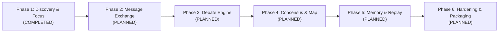

# TRIAD — Development Roadmap & Phase Gating

This document outlines the phased engineering milestones, feature mapping, and quality gates for the TRIAD Local AI Consensus Workspace.

---

## Roadmap Overview & Feature Matrix

| Phase | Milestone Name | Status | Modules Implemented | Key Deliverables |
|---|---|---|---|---|
| **Phase 1** | Desktop Discovery & Connection | **COMPLETED** | MOD-01 | Win32 discovery, HWND/PID tracking, window focus, SQLite settings, PySide6 UI. |
| **Phase 2** | User-Controlled Message Exchange | **COMPLETED** | MOD-02, MOD-14 | Prompt staging, safe clipboard bridge, import modals, response sealing, SHA-256 integrity, session restore. |
| **Phase 3** | Reasoning & Cross-Model Debate Engine | Planned | MOD-03, MOD-04, MOD-05, MOD-06, MOD-11 | Epistemic independence (Round 1), critique prompts, Devil's Advocate mode, 5 reasoning modes. |
| **Phase 4** | Consensus, Balloting & Disagreement Map | Planned | MOD-07, MOD-08, MOD-09, MOD-12 | Deterministic voting (3/3, 2/3), proposal equivalence, Minority Reports, Disagreement Map, human overrides. |
| **Phase 5** | Shared Memory, Replay & Export | Planned | MOD-10, MOD-13 | Versioned SQLite relational schema, interactive timeline replay, Markdown/JSON/HTML export. |
| **Phase 6** | Hardening, OS Matrix & Packaging | Planned | MOD-01–14 | Standalone PyInstaller binary, Windows 10/11 testing matrix, performance tuning. |

---

## Phase Details & Acceptance Criteria

### Phase 1: Native Desktop Application Connection (COMPLETED)
- **Status**: Operational & Verified (`29/29 tests passing`).
- **Core Capabilities**:
  - Discovers running instances of ChatGPT Desktop, Claude Desktop, and Gemini Desktop.
  - Resolves multi-window ambiguities with interactive user selection.
  - Restores minimized windows and brings target windows to foreground.
  - Continuous background health monitoring detecting window closes and process termination.
  - Local SQLite preference storage without saving transient runtime handles across reboots.
- **Acceptance Gate**:
  - All 10 acceptance scenarios passing in automated test suite.
  - Clean headless PySide6 initialization.
  - Verified PyInstaller executable build.

---

### Phase 2: User-Controlled Message Exchange Bridge (COMPLETED)
- **Status**: Operational & Verified (`46/46 tests passing`).
- **Core Capabilities**:
  - `MOD-02 MessageExchangeBridge`: Isolated Round 1 prompt formulation across ChatGPT, Claude, and Gemini.
  - One-click **Copy & Focus**: Puts formatted prompt onto clipboard and raises the registered window via `WindowManager`.
  - `ResponseImportDialog`: Preloads clipboard, calculates live character/word counts, and displays SHA-256 checksums.
  - SQLite persistence with versioned migrations: `reasoning_sessions`, `session_prompts`, `session_responses`.
  - Session restoration: past sessions can be reloaded and reviewed without losing accepted responses.
  - Completion indicator: recognizes `3/3 Responses Collected — Independent Round Complete — Ready for Cross-Model Discussion`.
- **Acceptance Gate**:
  - All 17 Phase 2 unit & integration tests passing.
  - Round 1 isolation enforced: zero peer leakage in outbound prompts.
  - Rejection of empty inputs and unconfirmed duplicate submissions.
  - Response revisions tracked with incrementing revision numbers.

---

### Phase 3: Reasoning Session & Cross-Model Debate Engine (Next Milestone)
- **Status**: Planned (Architecture & Contracts Defined).
- **Core Capabilities**:
  - `MOD-03 ReasoningSessionManager`: Multi-round session state machine.
  - `MOD-04 IndependentReasoningEngine`: Round 1 epistemic isolation (sealed responses).
  - `MOD-05 CrossModelDebateEngine`: Automated synthesis of cross-model critique prompts.
  - `MOD-06 DevilsAdvocateEngine`: Adversarial stress-testing of emerging consensus.
  - `MOD-11 ReasoningModeManager`: Support for Quick Consensus, Deep Debate, Research Council, Code Review, and Creative Council.
- **Acceptance Gate**:
  - Independent round verified: no model receives peer answers until all 3 submit Round 1.
  - Debate round generation verified with mock responses.
  - Devil's Advocate correctly assigned to natural dissenter or rotating challenger.
  - Hard round limits strictly enforced.

---

### Phase 4: Deterministic Consensus, Balloting & Disagreement Map
- **Status**: Planned (Protocol Defined in `docs/CONSENSUS_PROTOCOL.md`).
- **Core Capabilities**:
  - `MOD-08 ConsensusEngine`: Deterministic ballot calculation (3/3 Unanimous, 2/3 Majority, No Consensus).
  - `MOD-07 ClaimAndEvidenceManager`: Structured claim extraction and evidence tracking.
  - `MOD-09 DisagreementMap`: Interactive visual claim matrix (Support vs Oppose).
  - Mandatory **Minority Report** generation on 2/3 majority votes.
  - `MOD-12 HumanOversight`: Human override modal with mandatory audit trail.
- **Acceptance Gate**:
  - Complete mathematical test suite verifying all voting permutations.
  - Automated generation of Minority Report on 2/3 split.
  - Interactive proposal ambiguity resolution flow.

---

### Phase 5: Shared Memory, Session Replay & Export
- **Status**: Planned (Schema Defined in `docs/DATA_MODEL.md`).
- **Core Capabilities**:
  - `MOD-10 SharedMemoryManager`: Full relational SQLite persistence across sessions, rounds, claims, ballots, and decisions.
  - Forward-only database migration runner.
  - `MOD-13 SessionReplayAndExport`: Step-by-step interactive visual replay of discussion evolution.
  - Self-contained exports to Markdown, JSON, and printable HTML.
- **Acceptance Gate**:
  - End-to-end session serialization and deserialization without data loss.
  - Migration idempotence: running migrations against existing databases causes zero corruption.
  - Validated Markdown and JSON export formats.

---

### Phase 6: Hardening, Packaging & Optimization
- **Status**: Planned.
- **Core Capabilities**:
  - Single-file or clean onedir PyInstaller Windows distribution.
  - Memory leak and idle CPU utilization audits (<1% idle CPU).
  - CI test matrix across clean Windows 10 and Windows 11 VMs.
- **Acceptance Gate**:
  - Standalone executable launches instantly without requiring pre-installed Python.
  - Clean uninstallation and zero orphaned registry or AppData remnants.
